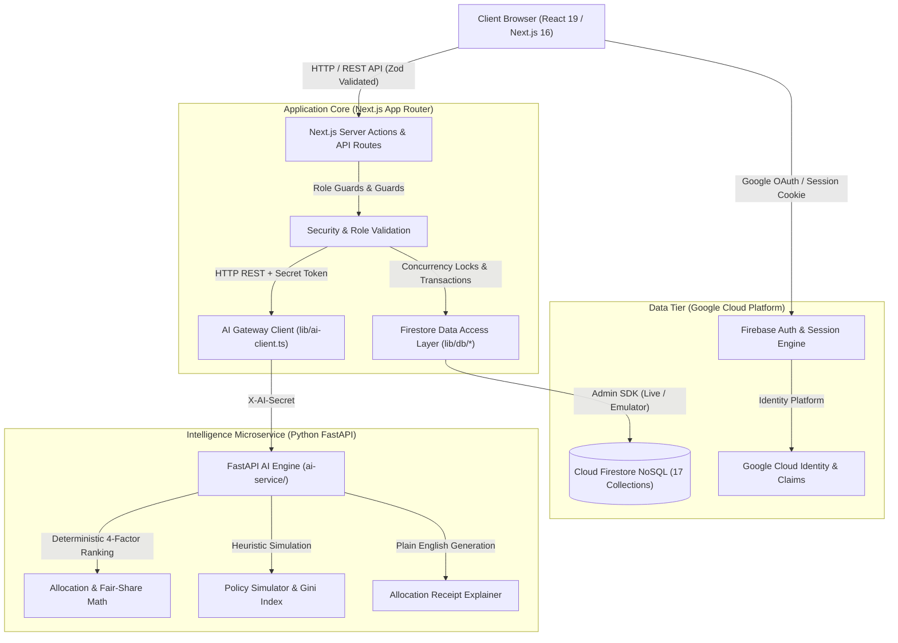
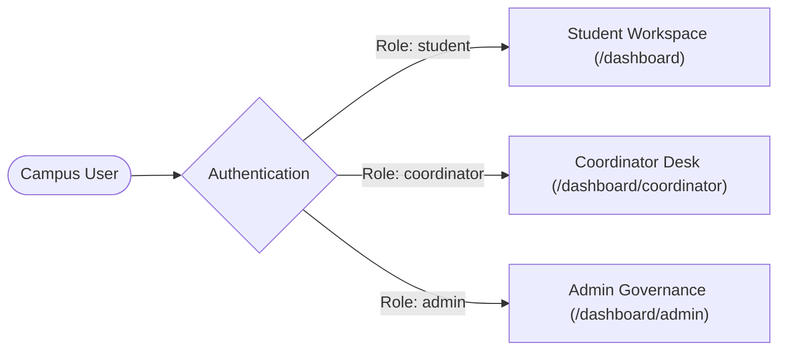
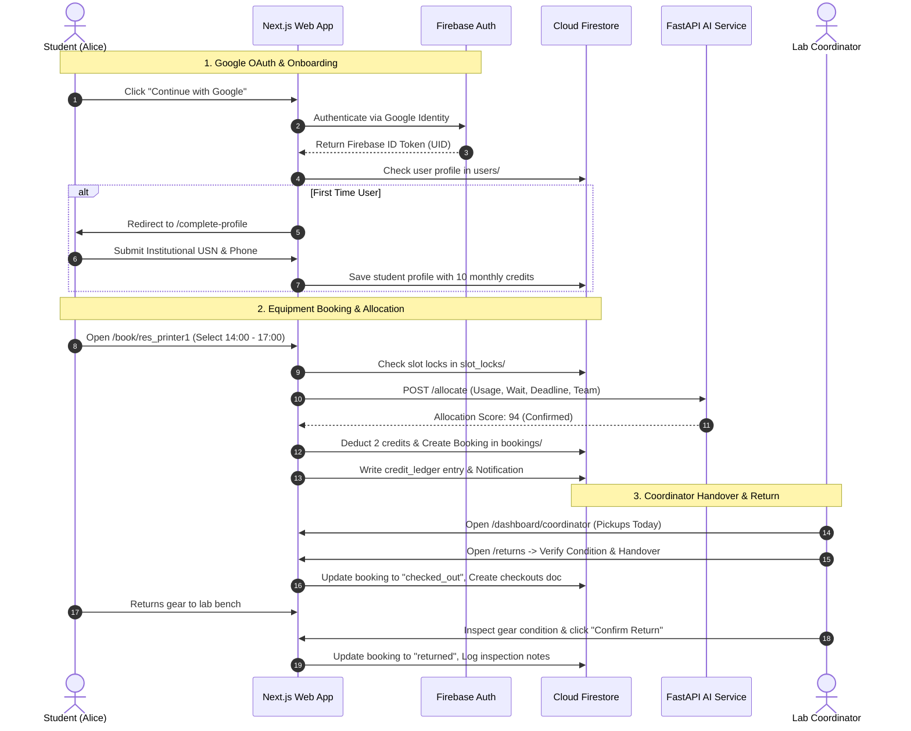

# Utilix — Share. Use. Build.

> **Next-Generation Campus Resource-Sharing Platform with Algorithmic Fairness, Explainable AI Allocation, and Transparent Governance**

[](https://nextjs.org/)
[](https://react.dev/)
[](https://www.typescriptlang.org/)
[](https://firebase.google.com/)
[](https://fastapi.tiangolo.com/)
[](https://tailwindcss.com/)
[](https://turbo.build/)
[](https://vitest.dev/)

---

## 📑 Table of Contents

- [1. Executive Summary & Problem Space](#1-executive-summary--problem-space)
- [2. System Architecture & Tech Stack](#2-system-architecture--tech-stack)
- [3. Algorithmic Fairness & Allocation Engine](#3-algorithmic-fairness--allocation-engine)
- [4. Role-Based Feature Suite](#4-role-based-feature-suite)
  - [Student Workspace](#student-workspace)
  - [Coordinator Operations Desk](#coordinator-operations-desk)
  - [Platform Administrator Governance](#platform-administrator-governance)
- [5. Database Schema & Collections](#5-database-schema--collections)
- [6. Quickstart & Installation Guide](#6-quickstart--installation-guide)
  - [One-Click Windows PowerShell Launch](#option-a-one-click-launch-windows-powershell-recommended)
  - [Manual Cross-Platform Launch](#option-b-manual-cross-platform-launch)
- [7. Pre-Configured Demo Personas](#7-pre-configured-demo-personas)
- [8. Seeding Presentation & Sample Data](#8-seeding-presentation--sample-data)
- [9. End-to-End User Journey Walkthrough](#9-end-to-end-user-journey-walkthrough)
- [10. REST API Reference](#10-rest-api-reference)
- [11. Testing & Quality Assurance](#11-testing--quality-assurance)
- [12. Design System & Soft Neo-Brutalism](#12-design-system--soft-neo-brutalism)

---

## 1. Executive Summary & Problem Space

### The Campus Bottleneck
Universities invest millions of dollars annually into research-grade apparatuses:
- **Additive Manufacturing & 3D Prototyping**: Bambu Lab X1-Carbon, Formlabs Form 3+ SLA resin printers, Prusa MK4.
- **Media & Broadcast Production**: Sony Alpha A7 IV 4K kits, Blackmagic Pocket Cinema 6K Pro, Canon EOS R5 C 8K.
- **Acoustic Suites & Audio Rigs**: RØDE Podcaster Pro II suites, sound-isolated acoustic booths, Sennheiser ambisonic gear.
- **Embedded Electronics & IoT**: Arduino Giga R1 sensor super-kits, ESP32-S3 AI edge dev kits, Raspberry Pi 5 clusters.
- **Robotics & AI Compute**: Niryo Ned 2 6-axis collaborative robotic arms, NVIDIA Jetson AGX Orin 64GB AI workstations.
- **RF & Measurement Lab Benches**: Rohde & Schwarz RTB2004 digital oscilloscopes, Keysight arbitrary waveform generators.

Historically, these tools remain trapped inside **departmental silos**. Engineering hardware sits idle while computer science, design, or fine arts students are barred from booking. When access is opened, naive first-come, first-served systems lead to bot-racing, slot-squatting, and phantom hoarders who reserve time and never show up.

### The Utilix Solution
1. **Free Baseline Allowance**: Every eligible campus student receives **2 free off-peak sessions per week** (costing 0 credits) for foundational academic coursework.
2. **Fair Credit Economy**: Students receive **10 monthly academic credits** to allocate toward scarce peak-demand equipment. Credits cannot be purchased with real money, permanently eliminating pay-to-win dynamics. Full credit refunds apply automatically for advance cancellations ($\ge$ 24 hours).
3. **Deterministic Multi-Factor Fair Allocation**: When multiple students or teams contest the same resource time window, Utilix evaluates competing requests through an objective mathematical formula balancing historical access, wait time, urgent deadlines, and interdisciplinary collaboration.
4. **Three-Tier Deterministic Tie-Breaking**: Fewest sessions this month $\to$ earliest request timestamp $\to$ cryptographic seeded lottery.
5. **15-Minute No-Show Reclamation**: Unclaimed slots are revoked after 15 minutes of inactivity and immediately promoted to Waitlist #1.
6. **Explainable AI with 100% Deterministic Fallback**: An AI service translates raw scoring weights into human-readable receipts explaining exactly why an allocation succeeded or went to waitlist. If the AI service is offline, the deterministic TypeScript rule engine renders the full receipt without service interruption.

---

## 2. System Architecture & Tech Stack



| Layer | Technologies & Specifications |
| :--- | :--- |
| **Frontend Framework** | **Next.js 16.4.3 (App Router)** with **React 19.3.0**, Turbopack compiler, Server Components (RSC) |
| **Language & Typing** | **TypeScript 5** in strict mode with 100% type coverage across models, APIs, and components |
| **Styling & UI Tokens** | **Tailwind CSS v4** with a custom **Soft Neo-Brutalism** token architecture, Lucide React icons |
| **Cloud Authentication** | **Google Cloud Identity / Firebase Authentication** with custom claims (`student`, `coordinator`, `admin`) |
| **Primary Database** | **Google Cloud Firestore NoSQL** with atomic multi-document transactions, run via Firebase Admin SDK |
| **AI Allocation Service** | **Python 3.10+ FastAPI** with NumPy and Pytest, running as a decoupled microservice |
| **Testing Harness** | **Vitest 5** for unit & pure rule testing, Pytest for AI service, integrated typechecking |

---

## 3. Algorithmic Fairness & Allocation Engine

When slot contention occurs, the allocation engine scores competing requests using an objective academic priority formula:

$$\text{Allocation Score} = (w_{\text{usage}} \times S_{\text{usage}}) + (w_{\text{wait}} \times S_{\text{wait}}) + (w_{\text{need}} \times S_{\text{need}}) + (w_{\text{team}} \times S_{\text{team}})$$

### Default Weights ($v1$ Policy)
- **Usage Fairness ($w_{\text{usage}} = 0.35$)**: Inversely proportional to the student's usage in the current cycle:
  $$S_{\text{usage}} = \max\left(0, 1 - \frac{\text{sessions\_used\_this\_month}}{\text{cycle\_cap}}\right)$$
- **Waiting Time Priority ($w_{\text{wait}} = 0.25$)**: Rewards users who have waited on waitlists or whose earlier requests were unfulfilled:
  $$S_{\text{wait}} = \min\left(1, \frac{\text{hours\_in\_queue}}{72}\right)$$
- **Declared Academic Need ($w_{\text{need}} = 0.20$)**: Boosts projects with an official capstone, thesis, or coursework deadline within 7 days:
  $$S_{\text{need}} = \begin{cases} 1.0 & \text{deadline} \le 7\text{ days} \\ 0.5 & \text{deadline} \le 14\text{ days} \\ 0.0 & \text{otherwise} \end{cases}$$
- **Interdisciplinary Team Bonus ($w_{\text{team}} = 0.20$)**: Incentivizes collaboration across colleges (e.g., Engineering student teaming up with Media or Design students):
  $$S_{\text{team}} = \min(1.0, 0.5 + 0.25 \times (\text{distinct\_departments} - 1))$$

### Deterministic Three-Tier Tie-Breaking
If two applicants achieve the identical score:
1. **Tier 1 — Fewest Sessions This Month**: The student who has accessed campus equipment least recently wins the slot.
2. **Tier 2 — Earliest Request Timestamp**: First to submit in the contention window.
3. **Tier 3 — Cryptographic Seeded Lottery**: Deterministic hash:
   $$\text{Hash}(\text{Seed} + \text{SlotID} + \text{UserID}) \pmod{1000}$$
   Ensures verifiable, reproducible fairness without human bias.

---

## 4. Role-Based Feature Suite

Utilix provides three specialized, isolated operational experiences governed by institutional role-based access control (RBAC).



---

### Student Workspace

| Screen / Feature | Route | Description |
| :--- | :--- | :--- |
| **Unified Student Home** | [`/dashboard`](file:///c:/Users/User/Desktop/Utilix/app/dashboard/page.tsx) | Live academic credit balance, free weekly off-peak sessions remaining, active equipment checkouts with countdown timers, upcoming bookings, and unread notification alerts. |
| **Equipment Directory** | [`/resources`](file:///c:/Users/User/Desktop/Utilix/app/%28workflow%29/resources/page.tsx) | Browse 18 research-grade campus apparatuses across 6 departments with real-time availability filters, specifications, location maps, and safety prerequisites. |
| **Interactive Slot Booking** | [`/book/[id]`](file:///c:/Users/User/Desktop/Utilix/app/%28workflow%29/book/%5Bid%5D/page.tsx) | Interactive time-slot picker, team member selector for interdisciplinary score boosts, declared project deadline input, and live credit cost estimation. |
| **Lifecycle Request Tracker** | [`/requests`](file:///c:/Users/User/Desktop/Utilix/app/%28workflow%29/requests/page.tsx) | Full status ledger (`confirmed`, `checked_out`, `pending_approval`, `waitlisted`, `returned`, `cancelled`) with 1-click advance cancellation and automatic credit refunds. |
| **Conflict & Alternatives** | [`/conflicts`](file:///c:/Users/User/Desktop/Utilix/app/%28workflow%29/conflicts/page.tsx) | Transparent view of slot contention, waitlist rank #1 indicators, and AI-powered recommendations for alternative equipment and open time slots. |
| **Qualifications & Badges** | [`/dashboard/training`](file:///c:/Users/User/Desktop/Utilix/app/dashboard/training/page.tsx) | Track institutional safety certifications (3D Printing, Cinema Cameras, Sound Engineering, Robotics) and submit verification requests for restricted gear. |
| **Notification Center** | [`/dashboard/notifications`](file:///c:/Users/User/Desktop/Utilix/app/dashboard/notifications/page.tsx) | Real-time alerts for booking confirmations, coordinator approval notices, waitlist promotions, and equipment return reminders. |
| **Credit History & Issues** | [`/history`](file:///c:/Users/User/Desktop/Utilix/app/history/page.tsx) | Three-tab ledger displaying all past booking records, credit deposit/deduction receipts, and equipment maintenance reports. |

---

### Coordinator Operations Desk

| Screen / Feature | Route | Description |
| :--- | :--- | :--- |
| **Operations Command Center** | [`/dashboard/coordinator`](file:///c:/Users/User/Desktop/Utilix/app/dashboard/coordinator/page.tsx) | Daily operational overview displaying **Pickups Today**, **Active In-Use Equipment**, **Returns Today**, and an **Overdue Alert Banner** with student contact details. |
| **Equipment Handoff & Returns** | [`/returns`](file:///c:/Users/User/Desktop/Utilix/app/%28workflow%29/returns/page.tsx) | Digital checkout desk for equipment check-in/check-out. Records condition logs before handover, inspects returned items, and tags overdue equipment. |
| **Approvals Queue** | [`/approvals`](file:///c:/Users/User/Desktop/Utilix/app/%28workflow%29/approvals/page.tsx) | Review restricted equipment reservations requiring lab supervisor protocol checks (e.g., chemical resin vats, high-speed cinema rigs) with approve/reject actions and notes. |
| **Inventory Management** | [`/dashboard/coordinator/resources`](file:///c:/Users/User/Desktop/Utilix/app/dashboard/coordinator/resources/page.tsx) | Toggle equipment operational status (`available`, `maintenance`, `retired`), update safety prerequisites, and log inspection timestamps. |
| **Training Certifications** | [`/dashboard/coordinator/training`](file:///c:/Users/User/Desktop/Utilix/app/dashboard/coordinator/training/page.tsx) | Review pending student training requests, verify practical exam completions, and grant category badges. |

---

### Platform Administrator Governance

| Screen / Feature | Route | Description |
| :--- | :--- | :--- |
| **Campus Telemetry & KPIs** | [`/dashboard/admin`](file:///c:/Users/User/Desktop/Utilix/app/dashboard/admin/page.tsx) | Campus-wide utilization rate, Gini fairness index ($0.0 = \text{perfect parity}$), fair-share ratio, active student users, and cross-departmental booking distributions. |
| **Algorithmic Policy Simulator** | [`/dashboard/admin/policy`](file:///c:/Users/User/Desktop/Utilix/app/dashboard/admin/policy/page.tsx) | Live mathematical policy tuning: adjust usage, wait time, and deadline weights with real-time historical simulation before committing changes. |
| **Compliance Audit Trail** | [`/dashboard/admin/audit`](file:///c:/Users/User/Desktop/Utilix/app/dashboard/admin/audit/page.tsx) | Immutable, timestamped audit log of all system actions: booking creations, supervisor overrides, policy updates, and safety badge certifications. |
| **Hardware Health & Telemetry** | [`/dashboard/admin/insights`](file:///c:/Users/User/Desktop/Utilix/app/dashboard/admin/insights/page.tsx) | Contended equipment analysis, underutilized equipment reports, and hardware maintenance issue feeds. |
| **Data Export** | [`/dashboard/admin/export`](file:///c:/Users/User/Desktop/Utilix/app/dashboard/admin/export/page.tsx) | Export campus usage datasets and audit logs in JSON or CSV format for university accreditation reports. |

---

## 5. Database Schema & Collections

Utilix standardizes on **17 strongly-typed Firestore collections** governed by [`COLLECTIONS`](file:///c:/Users/User/Desktop/Utilix/lib/types/index.ts#L110-L128). Timestamps are stored as native Firestore `Timestamp` objects and converted to ISO 8601 strings in the presentation layer.

```
firestore/
├── users/                   # Campus profiles, roles, credits, free sessions
├── departments/             # Academic faculties (ENG, CSE, MED, DSN, ART, SCI)
├── resources/               # Equipment catalog, specs, locations, training rules
├── availability_windows/    # Recurring Mon-Fri & date-specific capacity schedules
├── bookings/                # Slot reservations, lifecycle states, allocation scores
├── bundles/                 # Multi-resource project packages
├── waitlist/                # Ranked contention queues with priority scores
├── approvals/               # Coordinator supervisor decisions with notes
├── checkouts/               # Handover condition logs, return checks, overdue flags
├── issue_reports/           # Maintenance tickets, sensor faults, damage logs
├── training_certifications/ # Approved category badges (User × TrainingType)
├── training_requests/       # Student certification applications under review
├── credit_ledger/           # Immutable audit log of all credit balance deltas
├── notifications/           # Push/in-app alert feed with read/unread flags
├── policies/                # Active versioned allocation weights & peak windows
├── audit_log/               # Campus compliance & governance event stream
└── slot_locks/              # Concurrency locks for atomic reservation holds
```

---

## 6. Quickstart & Installation Guide

### Prerequisites
- **Node.js**: `v20.x` or `v18.17+`
- **Package Manager**: `npm`
- **Python**: `3.10+` with `pip` (for local AI allocation microservice)
- **Windows PowerShell**: Supported with native helper scripts

---

### Option A: One-Click Launch (Windows PowerShell — Recommended)

Utilix includes an automated PowerShell orchestrator that detects your environment, verifies Node and Python, installs missing dependencies, seeds presentation data, and starts both services:

```powershell
# In Windows PowerShell:
.\start.ps1
```

#### Startup Script Flags
```powershell
# Launch connected to live Google Firebase Cloud Authentication & Firestore:
.\start.ps1 -Mode cloud

# Launch in simulated zero-config demo mode:
.\start.ps1 -Mode demo

# Skip launching the Python AI service (Next.js deterministic fallback handles allocations):
.\start.ps1 -SkipAi

# Run on custom ports:
.\start.ps1 -Port 3000 -AiPort 8000
```

---

### Option B: Manual Cross-Platform Launch

#### 1. Clone & Install Dependencies
```bash
git clone https://github.com/Sooraj03-dev/Utilix.git
cd Utilix

# Install Frontend & Backend dependencies
npm install

# Install Python AI Microservice dependencies
cd ai-service
pip install -r requirements.txt
cd ..
```

#### 2. Configure Environment Variables
Copy the environment template files:
```bash
cp .env.example .env.local
cp ai-service/.env.example ai-service/.env
```

Ensure `AI_SERVICE_SECRET` matches in both `.env.local` and `ai-service/.env`.

#### 3. Seed Comprehensive Presentation Data
```bash
# Seed Cloud Firestore with presentation dataset:
$env:ALLOW_SEED="true"; npx tsx scripts/seed.ts demo

# Or generate local mock fixtures:
npm run seed mock
```

#### 4. Launch Development Servers
Open two terminal windows:

```bash
# Terminal 1 — Next.js 16 Web Application:
npm run dev

# Terminal 2 — Python FastAPI Intelligence Service:
npm run dev:ai
```

Open **`http://localhost:3000`** in your browser.

---

## 7. Pre-Configured Demo Personas

When running in demo mode or using email/password authentication, the following accounts are pre-seeded:

| Persona | Role | Email | Password | Assigned Resources & Access |
| :--- | :--- | :--- | :--- | :--- |
| **Sooraj Chakravarthy** | `student` | *Google Sign-In* | *Google Account* | Active in-use checkout, 2 upcoming bookings, waitlist #1, 18 credits |
| **Aarav Sharma** | `student` | `student.test@utilix.edu` | `UtilixPassword2026!` | Niryo Robot Arm session, Oscilloscope checkout, 16 credits |
| **Priya Nair (Student 01)** | `student` | `student01@utilix.local` | `UtilixPassword2026!` | Media camera booking, 3D printer certification, 25 credits |
| **Dr. Sarah Lin** | `coordinator` | `coordinator.test@utilix.edu` | `UtilixPassword2026!` | Manages Robotics, 3D Printers, Embedded Labs & Oscilloscopes |
| **Elena Rostova** | `coordinator` | `coord-media@utilix.local` | `UtilixPassword2026!` | Manages Cinema Cameras, Audio Booths & Broadcast Suites |
| **David Kim** | `coordinator` | `coord-makerspace@utilix.local` | `UtilixPassword2026!` | Manages Makerspace, CNC, Team Rooms & AI Stations |
| **Marcus Vance** | `admin` | `admin.test@utilix.edu` | `UtilixPassword2026!` | Campus-wide governance, policy tuning, telemetry & audit logs |

---

## 8. Seeding Presentation & Sample Data

Utilix features a dedicated batch-seeder in [`scripts/seed.ts`](file:///c:/Users/User/Desktop/Utilix/scripts/seed.ts) that populates **all 17 Firestore collections** with fresh, dynamic data anchored to the current date:

```bash
# Seed the live Firebase environment with presentation suites:
$env:ALLOW_SEED="true"; npx tsx scripts/seed.ts demo
```

### What Gets Populated
- **18 Campus Resources**: High-spec equipment across 6 departments with recurring Mon–Fri (08:00–20:00) availability windows.
- **Personalized Student Suites**: The logged-in Google user and test students automatically receive:
  - Upcoming confirmed booking for **Today** (Bambu Lab X1-Carbon).
  - Upcoming confirmed booking for **Tomorrow** (Sony Alpha A7 IV Cinema 4K).
  - Active in-use checkout running **Right Now** (Arduino Giga R1 Super-Kit).
  - Pending supervisor approval request (Formlabs Form 3+ SLA Resin Printer).
  - Waitlist position #1 slot (Blackmagic Pocket Cinema 6K Pro).
  - Past completed sessions with condition inspection reports.
  - 3 unread notifications and 2 read notifications.
  - 3 verified safety certificates + 1 pending training request.
  - Academic credit ledger records with stipend deposits and usage deductions.
- **Coordinator Operational Queue**:
  - **Pickups Today**: Confirmed bookings scheduled for equipment handover today.
  - **Returns Today**: Checkouts due for return today.
  - **Overdue Returns Alert**: A highlighted overdue item (Blackmagic 6K on `student-02`) with automated follow-up notices.
  - **Supervisor Approvals**: Pending restricted equipment requests.
- **Admin Telemetry & KPIs**:
  - 75 total bookings across 6 departments.
  - Fairness score calculated at **85/100 ("Fairly even")** with Gini index.
  - 30-day compliance audit trail and equipment health issue reports.

---

## 9. End-to-End User Journey Walkthrough



---

## 10. REST API Reference

### Authentication & Profiles
| Method | Endpoint | Description |
| :--- | :--- | :--- |
| `POST` | `/api/auth/session` | Exchanges Firebase ID Token for an `httpOnly` secure session cookie. |
| `GET` | `/api/me` | Returns the authenticated caller's identity, role, and department. |
| `POST` | `/api/user/profile` | First-time student profile completion; saves institutional USN and phone. |

### Workflow & Equipment Booking
| Method | Endpoint | Description |
| :--- | :--- | :--- |
| `GET` | `/api/workflow/resources` | List all resources with optional category, department, and search filters. |
| `GET` | `/api/workflow/resources/[id]/slots` | Get available time slots for a specific date with real-time capacity. |
| `POST` | `/api/workflow/eligibility` | Evaluates student prerequisites, credit balance, and active session limits. |
| `GET` | `/api/workflow/requests` | List bookings for current student (or all bookings for coordinators/admins). |
| `POST` | `/api/workflow/requests` | Atomically acquire slot locks, deduct credits, and create booking. |
| `POST` | `/api/workflow/requests/[id]/cancel` | Cancel an upcoming booking and trigger automatic credit refunds. |

### Coordinator Operations
| Method | Endpoint | Description |
| :--- | :--- | :--- |
| `POST` | `/api/workflow/requests/[id]/approve` | Coordinator approval for restricted equipment with supervisor notes. |
| `POST` | `/api/workflow/requests/[id]/reject` | Coordinator rejection for safety violations with credit refunds. |
| `POST` | `/api/workflow/checkout` | Records equipment handover with initial condition logs. |
| `POST` | `/api/workflow/checkin` | Inspects returned gear, logs condition reports, and closes active session. |

### Conflicts & Intelligence
| Method | Endpoint | Description |
| :--- | :--- | :--- |
| `POST` | `/api/workflow/waitlist/join` | Places user onto ranked waitlist for a contended slot. |
| `POST` | `/api/workflow/conflicts/[id]/resolve` | Resolves slot contention with mandatory supervisor override reason. |
| `POST` | `/api/workflow/issues` | Submits a hardware malfunction or missing component report. |

---

## 11. Testing & Quality Assurance

Utilix enforces comprehensive automated test coverage across all architectural tiers:

```bash
# 1. Run all 106 unit & integration tests:
npm run test

# 2. Run authentication & security guard tests:
npx vitest run tests/auth

# 3. Run seed contract & determinism tests:
npx vitest run tests/seed

# 4. Verify TypeScript static type safety:
npm run typecheck

# 5. Run Python AI microservice test suite:
npm run test:ai

# 6. Execute production production build (34 routes compiled):
npm run build
```

### Test Suite Summary
- **Unit & Integration Suite**: 106 tests passing ([`tests/unit/`](file:///c:/Users/User/Desktop/Utilix/tests/unit/)).
- **Authentication & RBAC Suite**: 55 tests passing ([`tests/auth/`](file:///c:/Users/User/Desktop/Utilix/tests/auth/)).
- **Seed Contract Suite**: 8 tests passing ([`tests/seed/`](file:///c:/Users/User/Desktop/Utilix/tests/seed/)).
- **Production Build**: 34 routes compiled cleanly via Next.js Turbopack.

---

## 12. Design System & Soft Neo-Brutalism

Utilix features a **Soft Neo-Brutalism** aesthetic tailored for institutional clarity and high physical contrast:

```
┌────────────────────────────────────────────────────────┐
│  Utilix Design System Palette                          │
├────────────────────────────────────────────────────────┤
│  Brand Yellow:     #FFD60A   (Primary accent & intake) │
│  Cream Surface:    #FFF9E6   (Warm background canvas)  │
│  Card White:       #FFFEF2   (Content card surface)    │
│  Ink Black:        #111111   (3.5px high-contrast rim) │
│  Success Green:    #22C55E   (Confirmed reservations)  │
│  Alert Red:        #EF4444   (Overdue return warnings) │
│  Sky Blue:         #38BDF8   (Active in-use sessions)  │
│  Warning Amber:    #F59E0B   (Waitlist queue status)   │
└────────────────────────────────────────────────────────┘
```

### Design Principles
- **Hard Offset Shadows**: `4px 4px 0px 0px #111111` for cards, `2px 2px 0px 0px #111111` for chips.
- **Physical Press Feedback**: Buttons physically shift by `translate(2.5px, 2.5px)` with reduced shadow depth on active click.
- **Multi-Modal Accessibility**: Status is **never indicated by color alone**. Every badge pairs an explicit SVG icon with bold uppercase typography.
- **Touch Targets**: All mobile and tablet interactive elements strictly satisfy minimum $44 \times 44\text{px}$ touch boundaries.

---

## 📄 License & Attribution

Developed with ❤️ by the **Google DeepMind Advanced Agentic Coding Team** in partnership with the **Utilix Engineering Group**.

Licensed under the [MIT License](LICENSE).
