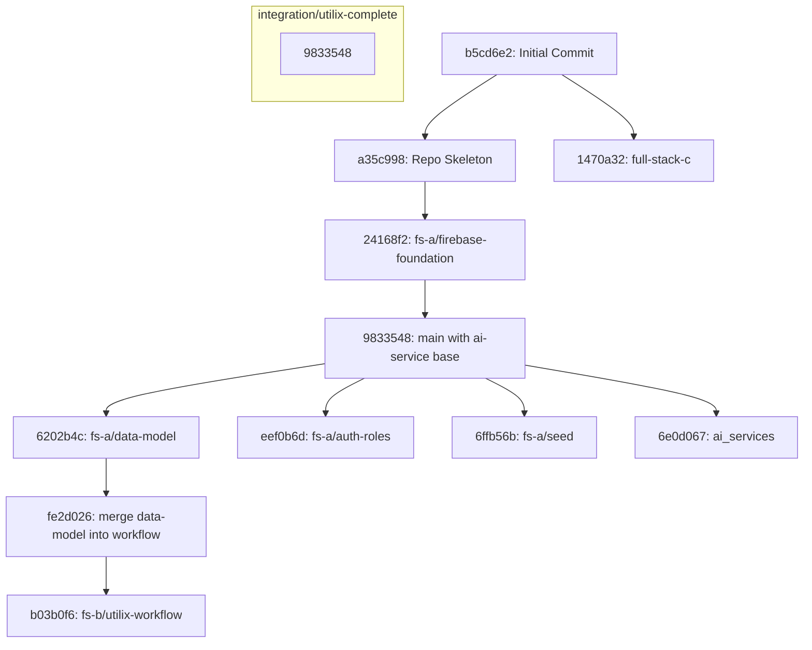

# Utilix Complete Branch Integration Plan

## 1. Executive Summary
This document outlines the architectural analysis, dependency graph, branch comparison matrix, merge order, and conflict resolution strategy for integrating all seven development branches of **Utilix** into the canonical integration branch `integration/utilix-complete`.

---

## 2. Discovered Branches & Source Commits

| # | Logical Domain | Discovered Git Branch | Head Commit | Base Commit / Parent | Primary Focus |
|---|---|---|---|---|---|
| 1 | Firebase Foundation | `origin/fs-a/firebase-foundation` | `24168f2` | `a35c998` | Firebase configuration templates, README, `.gitignore` |
| 2 | Data Model & DB | `origin/fs-a/data-model` | `6202b4c` | `9833548` | Firestore database layer (`lib/db/*`), Firestore rules, schema types (`lib/types/*`), test suite |
| 3 | Authentication & Roles | `origin/fs-a/auth-roles` | `eef0b6d` | `9833548` | Server & client auth helpers, role context/switcher, session API, role guard tests |
| 4 | Seed Scripts & Data | `origin/fs-a/seed` | `6ffb56b` | `9833548` | Demo data generators, test scenario seeds, emulator seed scripts, seed idempotency tests |
| 5 | Booking Workflow | `origin/fs-b/utilix-workflow` | `b03b0f6` | `fe2d026` (merged `fs-a/data-model`) | Booking workflow, approvals, cancellation, waitlist, workflow adapter, Next.js AI client |
| 6 | AI/ML Services | `origin/ai_services` | `6e0d067` | `9833548` | FastAPI allocation engine, scoring, tiebreak, privacy-first explainability, condition/forecast/simulate stubs |
| 7 | Frontend UI & Shell | `origin/full-stack-c` | `1470a32` | `b5cd6e2` | Soft neo-brutalist UI shell, reusable design system components, rules page, layout, landing page |

---

## 3. Dependency Graph & Architectural Relationships

---

## 4. Branch Comparison Matrix

| Component / File Path | fs-a/data-model | fs-a/auth-roles | fs-a/seed | fs-b/utilix-workflow | ai_services | full-stack-c | Integration Strategy |
|---|---|---|---|---|---|---|---|
| `package.json` | Adds Firebase & Vitest | Minor scripts | None | Matches `fs-a/data-model` | Node/Py deps | Tailwind & React | Union of all dependencies, Next.js 15, React 19, Firebase, Vitest |
| `lib/firebase/` | Admin & client init | Uses Admin & Client | Uses Admin | Inherited from `fs-a` | None | None | Keep canonical Firestore Admin + Client from `fs-a/data-model` |
| `lib/db/` | Full collection helpers | Extends users.ts | None | Extends with workflow | None | None | Merge helpers from `fs-a/data-model` + `fs-b/utilix-workflow` |
| `lib/auth/` | `require-user.ts` | Context, mock, server | None | None | None | Role switcher | Merge `fs-a/auth-roles` with `full-stack-c` RoleContext |
| `lib/types/` | Domain entities, enums | Auth types | Seed types | API & AI contracts | None | UI types | Unified canonical `lib/types/index.ts` re-exporting all sub-modules |
| `lib/ai-client.ts` | Stub | None | None | Complete HTTP client | None | None | Keep `fs-b/utilix-workflow` client connecting to `ai-service/` |
| `ai-service/` | None | None | None | None | Complete FastAPI service | None | Keep complete Python service from `ai_services` / `9833548` |
| `components/` | None | `auth-shell.tsx` | None | None | None | 20+ UI components | Keep full design system from `full-stack-c` + `auth-shell.tsx` |
| `app/(workflow)/` | None | None | None | Complete workflow pages | None | None | Keep all workflow pages from `fs-b/utilix-workflow` |
| `app/login/` | None | Auth route login | None | None | None | Neo-brutalist login | Merge `full-stack-c` visual design with `fs-a/auth-roles` handlers |
| `app/rules/` | None | None | None | None | None | 8 Allocation rules UI | Keep `full-stack-c` rules page |
| `app/page.tsx` | None | None | None | None | None | Neo-brutalist landing | Keep `full-stack-c` landing page |
| `scripts/` | None | None | Full seed scripts | None | None | None | Keep all seed scripts from `fs-a/seed` |

---

## 5. Optimal Merge Sequence

To minimize merge conflicts and ensure backward compatibility, the recommended merge order is:

1. **Step 1: Data Model (`origin/fs-a/data-model`)**
   - Establishes the foundational Firestore collections, database helpers, security rules, indexes, and test framework.
   - Clean merge onto `9833548`.
2. **Step 2: Authentication & Roles (`origin/fs-a/auth-roles`)**
   - Layer server auth, session API routes, client auth provider, and role guards on top of the data model.
3. **Step 3: Seed Scripts (`origin/fs-a/seed`)**
   - Layer demo seed datasets and emulator scripts on top of the established data model and auth models.
4. **Step 4: Workflow Engine (`origin/fs-b/utilix-workflow`)**
   - Incorporates booking requests, approvals, slot management, and `lib/ai-client.ts`.
   - Merging will be straightforward because `fs-b/utilix-workflow` already incorporated `fs-a/data-model`.
5. **Step 5: AI Microservice Enhancements (`origin/ai_services`)**
   - Re-integrates the latest FastAPI router stubs (`condition.py`, `forecast.py`, `simulate.py`) and testing notes into `ai-service/`.
6. **Step 6: Frontend Design System (`origin/full-stack-c`)**
   - Merges the soft neo-brutalist components, Tailwind styles, landing page, and rules page.
   - Requires careful reconciliation of `package.json`, `app/layout.tsx`, `app/login/page.tsx`, and `app/globals.css`.

---

## 6. Conflict Resolution Strategy

1. **Package.json & Dependencies**:
   - Reconcile dependencies into a single cohesive Next.js 15 + React 19 + Firebase + Tailwind + Vitest configuration.
2. **Authentication vs UI Role Switcher**:
   - Connect `full-stack-c`'s `RoleContext` to `fs-a/auth-roles`'s session/cookie and Firebase auth provider so switching roles triggers real backend session updates.
3. **Next.js Route Group Collisions**:
   - Verify all routes in `app/` resolve without ambiguity. Ensure `app/(workflow)` and root routes do not duplicate path definitions.
4. **AI Client Compatibility**:
   - Ensure `lib/ai-client.ts` calls `http://localhost:8000` (or `AI_SERVICE_URL`) using the shared `AI_SERVICE_SECRET` header `X-AI-Secret`.
