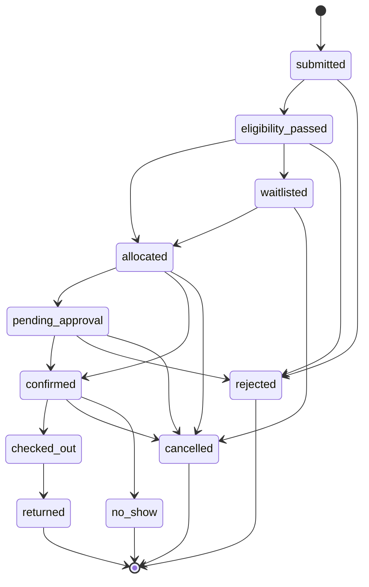

# Utilix — Firestore Data Model

> Owner: **A** · Last updated: 2026-10-29

---

## Table of Contents

1. [Collections](#collections)
2. [Slot Model](#slot-model)
3. [Slot Locking](#slot-locking)
4. [Credit Ledger Rules](#credit-ledger-rules)
5. [Status Flow](#status-flow)
6. [Read / Write Matrix](#read--write-matrix)

---

## Collections

All collections are **top-level** (no subcollections). Document IDs are auto-generated unless noted.

### `users`

| Field | Type | Example |
|---|---|---|
| role | `"student" \| "coordinator" \| "admin"` | `"student"` |
| name | string | `"Alice Chen"` |
| email | string | `"alice@university.edu"` |
| department_id | string (ref) | `"dept_eng"` |
| year | number | `3` |
| credit_balance | number | `8` |
| free_sessions_used | number | `1` |
| free_sessions_week | string (ISO week) | `"2026-W44"` |
| active | boolean | `true` |
| created_at | Timestamp | `2026-08-15T09:00:00Z` |

```json
{
  "role": "student",
  "name": "Alice Chen",
  "email": "alice@university.edu",
  "department_id": "dept_eng",
  "year": 3,
  "credit_balance": 8,
  "free_sessions_used": 1,
  "free_sessions_week": "2026-W44",
  "active": true,
  "created_at": "2026-08-15T09:00:00Z"
}
```

### `departments`

| Field | Type | Example |
|---|---|---|
| name | string | `"Engineering"` |
| code | string | `"ENG"` |

```json
{ "name": "Engineering", "code": "ENG" }
```

### `resources`

| Field | Type | Example |
|---|---|---|
| name | string | `"Prusa i3 MK4S #1"` |
| type | enum | `"printer_3d"` |
| department_id | string | `"dept_eng"` |
| coordinator_id | string | `"user_carol"` |
| location | string | `"Fab Lab Room 101"` |
| photo_url | string \| null | `null` |
| restricted | boolean | `false` |
| requires_training | string \| null | `"3d_printing_basic"` |
| credit_cost | number | `2` |
| max_session_minutes | number | `120` |
| status | `"available" \| "maintenance" \| "retired"` | `"available"` |
| last_inspection_at | Timestamp \| null | `"2026-10-01T14:00:00Z"` |

```json
{
  "name": "Prusa i3 MK4S #1",
  "type": "printer_3d",
  "department_id": "dept_eng",
  "coordinator_id": "user_carol",
  "location": "Fab Lab Room 101",
  "photo_url": null,
  "restricted": false,
  "requires_training": "3d_printing_basic",
  "credit_cost": 2,
  "max_session_minutes": 120,
  "status": "available",
  "last_inspection_at": "2026-10-01T14:00:00Z"
}
```

### `availability_windows`

| Field | Type | Example |
|---|---|---|
| resource_id | string | `"res_printer1"` |
| weekday | 0-6 \| null | `1` |
| date | `"YYYY-MM-DD"` \| null | `null` |
| start | `"HH:mm"` | `"09:00"` |
| end | `"HH:mm"` | `"17:00"` |
| slot_type | `"free" \| "credit" \| "blocked"` | `"free"` |
| note | string \| null | `null` |

```json
{
  "resource_id": "res_printer1",
  "weekday": 1,
  "date": null,
  "start": "09:00",
  "end": "17:00",
  "slot_type": "free",
  "note": null
}
```

### `training_certifications`

Doc ID = `${userId}_${trainingType}`

| Field | Type | Example |
|---|---|---|
| user_id | string | `"user_alice"` |
| training_type | string | `"3d_printing_basic"` |
| certified_by | string | `"user_carol"` |
| certified_at | Timestamp | `"2026-09-10T11:00:00Z"` |

```json
{
  "user_id": "user_alice",
  "training_type": "3d_printing_basic",
  "certified_by": "user_carol",
  "certified_at": "2026-09-10T11:00:00Z"
}
```

### `training_requests`

A student asks for a training they do not hold yet. `training_type` matches the
`requires_training` value on resources. Statuses: `pending`, `scheduled`,
`completed`, `declined` (only `pending` is produced by the student action).
Duplicate pending requests per (user, training_type) are blocked in a transaction.

| Field | Type | Example |
|---|---|---|
| user_id | string | `"user_bob"` |
| training_type | string | `"3d-printer"` |
| status | string | `"pending"` |
| created_at | Timestamp | `"2026-10-28T14:20:00Z"` |

```json
{
  "user_id": "user_bob",
  "training_type": "3d-printer",
  "status": "pending",
  "created_at": "2026-10-28T14:20:00Z"
}
```

Indexes: `user_id + status + created_at desc`, `training_type + status + created_at desc`.

### `bookings`

| Field | Type | Example |
|---|---|---|
| resource_id | string | `"res_printer1"` |
| user_id | string | `"user_alice"` |
| member_ids | string[] | `["user_alice"]` |
| team_department_ids | string[] | `["dept_eng"]` |
| bundle_id | string \| null | `null` |
| slot_start | Timestamp | `"2026-10-30T09:00:00Z"` |
| slot_end | Timestamp | `"2026-10-30T11:00:00Z"` |
| slot_ids | string[] | `["res_printer1_20261030T0900", "res_printer1_20261030T1000"]` |
| purpose | string | `"Print enclosure for capstone sensor array"` |
| declared_deadline | Timestamp \| null | `"2026-11-10T00:00:00Z"` |
| status | BookingStatus | `"confirmed"` |
| slot_type | `"free" \| "credit"` | `"credit"` |
| cost_credits | number | `2` |
| allocation_score | number \| null | `0.82` |
| decision_reason | string \| null | `"Highest fairness score; no contention on slot."` |
| decision_source | `"ai" \| "fallback" \| null` | `"ai"` |
| tiebreak | object \| null | `null` |
| policy_version | string | `"v1"` |
| created_at | Timestamp | `"2026-10-28T14:30:00Z"` |
| updated_at | Timestamp | `"2026-10-28T15:00:00Z"` |

```json
{
  "resource_id": "res_printer1",
  "user_id": "user_alice",
  "member_ids": ["user_alice"],
  "team_department_ids": ["dept_eng"],
  "bundle_id": null,
  "slot_start": "2026-10-30T09:00:00Z",
  "slot_end": "2026-10-30T11:00:00Z",
  "slot_ids": ["res_printer1_20261030T0900", "res_printer1_20261030T1000"],
  "purpose": "Print enclosure for capstone sensor array",
  "declared_deadline": "2026-11-10T00:00:00Z",
  "status": "confirmed",
  "slot_type": "credit",
  "cost_credits": 2,
  "allocation_score": 0.82,
  "decision_reason": "Highest fairness score; no contention on slot.",
  "decision_source": "ai",
  "tiebreak": null,
  "policy_version": "v1",
  "created_at": "2026-10-28T14:30:00Z",
  "updated_at": "2026-10-28T15:00:00Z"
}
```

### `bundles`

| Field | Type | Example |
|---|---|---|
| user_id | string | `"user_alice"` |
| booking_ids | string[] | `["bk_001", "bk_004"]` |
| status | `"pending" \| "confirmed" \| "cancelled"` | `"confirmed"` |
| created_at | Timestamp | `"2026-10-28T14:30:00Z"` |

```json
{
  "user_id": "user_alice",
  "booking_ids": ["bk_001", "bk_004"],
  "status": "confirmed",
  "created_at": "2026-10-28T14:30:00Z"
}
```

### `waitlist`

| Field | Type | Example |
|---|---|---|
| resource_id | string | `"res_printer1"` |
| slot_id | string | `"res_printer1_20261030T0900"` |
| booking_id | string | `"bk_003"` |
| user_id | string | `"user_bob"` |
| position | number | `1` |
| score | number | `0.58` |
| created_at | Timestamp | `"2026-10-28T16:10:00Z"` |

```json
{
  "resource_id": "res_printer1",
  "slot_id": "res_printer1_20261030T0900",
  "booking_id": "bk_003",
  "user_id": "user_bob",
  "position": 1,
  "score": 0.58,
  "created_at": "2026-10-28T16:10:00Z"
}
```

### `approvals`

| Field | Type | Example |
|---|---|---|
| booking_id | string | `"bk_002"` |
| requested_at | Timestamp | `"2026-10-29T08:15:00Z"` |
| decided_by | string \| null | `null` |
| decision | `"approved" \| "rejected" \| "pending"` | `"pending"` |
| note | string \| null | `null` |
| decided_at | Timestamp \| null | `null` |

```json
{
  "booking_id": "bk_002",
  "requested_at": "2026-10-29T08:15:00Z",
  "decided_by": null,
  "decision": "pending",
  "note": null,
  "decided_at": null
}
```

### `checkouts`

| Field | Type | Example |
|---|---|---|
| booking_id | string | `"bk_001"` |
| checked_out_by | string | `"user_alice"` |
| checked_out_at | Timestamp | `"2026-10-30T09:05:00Z"` |
| condition_before | string | `"good"` |
| returned_at | Timestamp \| null | `null` |
| condition_after | string \| null | `null` |
| notes | string \| null | `null` |
| photo_url | string \| null | `null` |
| overdue | boolean | `false` |

```json
{
  "booking_id": "bk_001",
  "checked_out_by": "user_alice",
  "checked_out_at": "2026-10-30T09:05:00Z",
  "condition_before": "good",
  "returned_at": null,
  "condition_after": null,
  "notes": null,
  "photo_url": null,
  "overdue": false
}
```

### `issue_reports`

| Field | Type | Example |
|---|---|---|
| booking_id | string | `"bk_001"` |
| resource_id | string | `"res_printer1"` |
| user_id | string | `"user_alice"` |
| category | `"damage" \| "malfunction" \| "missing" \| "other"` | `"malfunction"` |
| notes | string | `"Extruder clogged during print"` |
| photo_url | string \| null | `null` |
| status | `"open" \| "investigating" \| "resolved"` | `"open"` |
| created_at | Timestamp | `"2026-10-30T10:30:00Z"` |

```json
{
  "booking_id": "bk_001",
  "resource_id": "res_printer1",
  "user_id": "user_alice",
  "category": "malfunction",
  "notes": "Extruder clogged during print",
  "photo_url": null,
  "status": "open",
  "created_at": "2026-10-30T10:30:00Z"
}
```

### `credit_ledger`

Doc ID = `idempotency_key` (repeats are no-ops).

| Field | Type | Example |
|---|---|---|
| user_id | string | `"user_alice"` |
| delta | number | `-2` |
| reason | CreditReason | `"booking_charge"` |
| booking_id | string \| null | `"bk_001"` |
| balance_after | number | `8` |
| idempotency_key | string | `"charge_bk_001"` |
| created_at | Timestamp | `"2026-10-28T15:00:00Z"` |

```json
{
  "user_id": "user_alice",
  "delta": -2,
  "reason": "booking_charge",
  "booking_id": "bk_001",
  "balance_after": 8,
  "idempotency_key": "charge_bk_001",
  "created_at": "2026-10-28T15:00:00Z"
}
```

### `notifications`

| Field | Type | Example |
|---|---|---|
| user_id | string | `"user_alice"` |
| type | NotificationType | `"booking_confirmed"` |
| title | string | `"Booking Confirmed"` |
| body | string | `"Your 3D printer booking on Oct 30 at 09:00 is confirmed."` |
| link | string \| null | `"/requests/bk_001"` |
| read | boolean | `false` |
| created_at | Timestamp | `"2026-10-28T15:00:00Z"` |

```json
{
  "user_id": "user_alice",
  "type": "booking_confirmed",
  "title": "Booking Confirmed",
  "body": "Your 3D printer booking on Oct 30 at 09:00 is confirmed.",
  "link": "/requests/bk_001",
  "read": false,
  "created_at": "2026-10-28T15:00:00Z"
}
```

### `policies`

Doc ID = `v${version}`. Only one doc has `is_active: true` at a time.

| Field | Type | Example |
|---|---|---|
| version | number | `1` |
| is_active | boolean | `true` |
| monthly_credits | number | `10` |
| free_sessions_per_week | number | `2` |
| max_active_bookings | number | `3` |
| slot_minutes | number | `60` |
| cancel_refund_hours | number | `24` |
| weights | object | `{ usage_fairness: 0.35, waiting_time: 0.25, declared_need: 0.20, interdisciplinary_bonus: 0.20 }` |
| tiebreak_order | string[] | `["fewest_sessions_month", "earliest_request", "seeded_lottery"]` |
| peak_definition | object[] | `[{ weekday: 1, start: "10:00", end: "14:00" }]` |
| deadline_window_days | number | `7` |
| created_by | string | `"user_dan"` |
| created_at | Timestamp | `"2026-10-01T08:00:00Z"` |

```json
{
  "version": 1,
  "is_active": true,
  "monthly_credits": 10,
  "free_sessions_per_week": 2,
  "max_active_bookings": 3,
  "slot_minutes": 60,
  "cancel_refund_hours": 24,
  "weights": {
    "usage_fairness": 0.35,
    "waiting_time": 0.25,
    "declared_need": 0.20,
    "interdisciplinary_bonus": 0.20
  },
  "tiebreak_order": ["fewest_sessions_month", "earliest_request", "seeded_lottery"],
  "peak_definition": [{ "weekday": 1, "start": "10:00", "end": "14:00" }],
  "deadline_window_days": 7,
  "created_by": "user_dan",
  "created_at": "2026-10-01T08:00:00Z"
}
```

### `audit_log`

| Field | Type | Example |
|---|---|---|
| actor_id | string | `"user_alice"` |
| action | AuditAction | `"booking_created"` |
| entity_type | string | `"booking"` |
| entity_id | string | `"bk_001"` |
| rule_version | string | `"v1"` |
| scores | object \| null | `{ usage: 0.5, waiting: 0.3 }` |
| reason | string \| null | `"New booking submitted"` |
| created_at | Timestamp | `"2026-10-28T14:30:00Z"` |

```json
{
  "actor_id": "user_alice",
  "action": "booking_created",
  "entity_type": "booking",
  "entity_id": "bk_001",
  "rule_version": "v1",
  "scores": null,
  "reason": "New booking submitted",
  "created_at": "2026-10-28T14:30:00Z"
}
```

### `slot_locks`

Doc ID = slotId (e.g. `res_printer1_20261030T0900`).

| Field | Type | Example |
|---|---|---|
| booking_id | string | `"bk_001"` |
| user_id | string | `"user_alice"` |
| locked_at | Timestamp | `"2026-10-28T15:00:00Z"` |

```json
{
  "booking_id": "bk_001",
  "user_id": "user_alice",
  "locked_at": "2026-10-28T15:00:00Z"
}
```

---

## Slot Model

- Fixed-length slots, default **60 minutes** (configurable via `policies.slot_minutes`).
- **Slot ID format**: `${resourceId}_${YYYYMMDDTHHmm}` in UTC.
  - Example: `res_printer1_20261030T0900`
- A booking spanning multiple slots (e.g. 2 hours) covers consecutive slot IDs.
- Helpers in `/lib/db/slots.ts`:
  - `toSlotId(resourceId, date)` — single slot ID
  - `slotIdsForRange(resourceId, start, end, slotMinutes)` — array of slot IDs
  - `isPeakSlot(date, policy)` — check against `policy.peak_definition`

---

## Slot Locking

Collection: `slot_locks`, doc ID = slotId.

1. `acquireSlotLocks(tx, bookingId, userId, slotIds)` — inside a Firestore transaction, tries to create a `slot_locks` doc for each slotId. If any doc already exists, the transaction throws `SlotTakenError`.
2. `releaseSlotLocks(tx, slotIds)` — deletes the lock docs inside a transaction.
3. Only one booking can hold a slot lock at a time; concurrent requests are resolved by Firestore's optimistic concurrency (transaction retry).

---

## Credit Ledger Rules

- `users.credit_balance` is **ONLY** modified through `/lib/db/ledger.ts`.
- `applyCredit({ tx, userId, delta, reason, bookingId?, idempotencyKey })`:
  - Runs inside a Firestore transaction.
  - Reads user doc and checks for existing ledger doc (idempotency).
  - If ledger doc exists → no-op, returns existing entry.
  - If `balance + delta < 0` → throws `InsufficientCreditsError`.
  - Writes ledger doc (ID = idempotency_key) with `balance_after`.
  - Updates `users.credit_balance` atomically.
- `grantMonthlyCredits(userId, policy)`:
  - Idempotent per user per month (key `grant_${userId}_${YYYY-MM}`).
- `reconcileBalance(userId)`:
  - Recomputes balance from the full ledger and reports mismatches.
- **All reads before all writes** within a transaction (Firestore requirement).

---

## Status Flow



**Terminal states**: `returned`, `cancelled`, `rejected`, `no_show`.

---

## Read / Write Matrix

| Collection | Client reads | Server writes | Who writes |
|---|---|---|---|
| users | Own doc (any role); all docs (staff) | firebase-admin | A (helpers), B (workflow) |
| departments | Any signed-in | firebase-admin | A (seed) |
| resources | Any signed-in | firebase-admin | A (helpers), B (workflow) |
| availability_windows | Any signed-in | firebase-admin | A (helpers) |
| training_certifications | Own + staff | firebase-admin | A (helpers) |
| training_requests | Own + staff | firebase-admin | A (training action), target Part 5 (decisions) |
| bookings | Own (user_id or member_ids) + staff | firebase-admin | B (workflow), AI (scores via B) |
| bundles | Own + staff | firebase-admin | B (workflow) |
| waitlist | Own + staff | firebase-admin | B (workflow) |
| approvals | Booking owner + staff | firebase-admin | B (workflow) |
| checkouts | Booking owner + staff | firebase-admin | B (workflow) |
| issue_reports | Own + staff | firebase-admin | B (workflow) |
| credit_ledger | Own + staff | firebase-admin (ledger.ts only) | A (ledger), B (via ledger) |
| notifications | Own + staff | firebase-admin | B (workflow), A (helpers) |
| policies | Any signed-in | firebase-admin | A (policy helpers) |
| audit_log | Admin only | firebase-admin | A (audit helper), B (via audit) |
| slot_locks | Staff only | firebase-admin | A (slot helpers), B (via slots) |

> **Key rule**: ALL client writes are denied. The client SDK is read-only. All mutations go through Next.js route handlers or Server Actions using firebase-admin.

